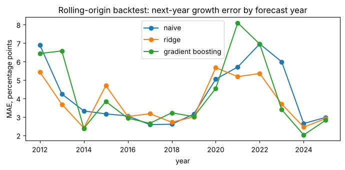

# Forecasting US housing markets with Zillow's public data

Can we predict how fast home values will grow in each US metro over the next year, using only what is known today? This project builds that forecast for roughly 900 metros from Zillow's public data, tests it honestly over time, and asks where it breaks.

Everything runs top to bottom in one Jupyter notebook: [`housing_market_forecast.ipynb`](housing_market_forecast.ipynb).

## What's in it

1. **Forecasting next-year growth** (scikit-learn). Leakage-free features at the end of each year (6-month momentum, 1- and 3-year growth, volatility, price level, the national trend) predict each metro's growth over the next 12 months. Models: a naive baseline (last year's growth carries on), ridge regression, and gradient boosting.
2. **Market metrics in SQL** (DuckDB): year-over-year growth, price-to-rent ratios, the fastest-growing metro per state, and peak-to-now drawdowns, with CTEs and window functions.
3. **The same pipeline in PySpark**: DataFrames, window specs, pivots and Spark SQL.
4. **Segmenting metros** by how their market behaves (k-means, silhouette scores, PCA).

## Results

| Validation | Naive | Ridge | Gradient boosting |
|---|---|---|---|
| Time-based holdout (train to 2019, test 2020–2025), MAE | 4.88 pp | **4.26 pp** | 4.37 pp |
| Rolling-origin backtest (2012–2025, expanding window), mean MAE | 4.16 pp | **3.81 pp** | 4.20 pp |

Ridge regression beats the naive baseline by about 13% on the holdout and 8% across the backtest. The year-by-year errors show where every model struggles: regime changes such as the 2021–22 run-up. Recent momentum is the strongest driver (permutation importance).



**Next steps:** rent features from ZORI, prediction intervals with quantile loss, reconciling metro forecasts with state and national totals (hierarchical forecasting), and per-metro ARIMA baselines.

## Run it

```bash
git clone https://github.com/rachelseibel/housing-market-forecast
cd housing-market-forecast
bash setup.sh          # macOS: creates .venv, installs requirements, finds Java 17+ for PySpark
```

Then open the notebook in VS Code or Jupyter and pick the `.venv` kernel.

### Data

Download two CSVs from [Zillow Research](https://www.zillow.com/research/data/) (Geography: Metro & U.S.) into `data/`:

- Home values (ZHVI, single-family and condo, mid-tier, smoothed, seasonally adjusted): `Metro_zhvi_uc_sfrcondo_tier_0.33_0.67_sm_sa_month.csv`
- Rents (ZORI, all homes plus multifamily, smoothed): `Metro_zori_uc_sfrcondomfr_sm_month.csv`

The CSVs are not committed. Without them the notebook runs on synthetic data with the same layout. Results above use data through September 2026.

## Tools

Python, pandas, scikit-learn, DuckDB (SQL), PySpark, matplotlib.
